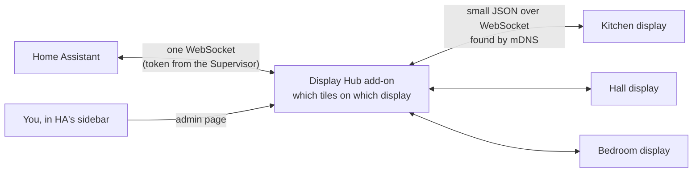

# Home Automation Display

Wall panels for Home Assistant, built on the ESP32 "Cheap Yellow Display",
a 2.8" 320×240 touchscreen that costs about the price of a light bulb.
Each display shows the lights, switches, sensors, thermostat, scenes and
so on that you assign to it, and taps control them. Any number of displays
share one **hub**, which runs as a Home Assistant add-on and is where you
decide what goes on which display.



- **Displays introduce themselves.** A new display joins WiFi, finds the
  hub over mDNS, and appears in the hub's admin page. **Identify** makes it
  show its id, so you can tell which panel is which.
- **Pick tiles in the admin page.** Choose from your Home Assistant
  entities, grouped by device, room, or room then device, with search and type filters, in up
  to 6 pages of 8. Saving updates the
  display at once, with no reflashing.
- **Many entity types.** Lights (dimming), fans (speed), covers (position),
  switches, locks, automations, sirens, scenes, scripts, buttons, sensors
  coloured by level (CO2, VOC, PM2.5, battery...), binary sensors, people,
  weather, and thermostats. [The full list](docs/entities.md).
- **No secrets on the displays.** Only the hub talks to Home Assistant.
- **Try it without hardware or Home Assistant.** The hub has a mock house
  and a virtual display in the browser.

## Quick start

**1. Install the hub** in Home Assistant (HA OS or Supervised):

[](https://my.home-assistant.io/redirect/supervisor_add_addon_repository/?repository_url=https%3A%2F%2Fgithub.com%2Fgeekychris%2FHomeAutomationDisplay)

Then install and start **Display Hub**, and open **Displays** in the
sidebar. For HA Container or Core, use Docker or a virtualenv instead; see
[install.md](docs/install.md#1-the-hub).

**2. Flash a display:**

```sh
scripts/flash.sh                  # the 2.8" board; needs PlatformIO, or esptool with a release .bin
BOARD=st7796r scripts/flash.sh    # 3.5"/4.0" resistive; sunton35c for the capacitive 3.5"
```

**3. On the display:** calibrate the touch, then gear → **WiFi**. It finds
the hub by itself.

**4. In Displays:** pick the new display, **Identify**, add tiles, then
**Save to display**.

**Just trying it?**

```sh
make hub        # mock house: http://localhost:8390/, virtual display: http://localhost:8390/virtual
```

## Documentation

| | |
|---|---|
| [docs/install.md](docs/install.md) | Installing the hub (add-on, Docker, venv) and the firmware; first-time setup; troubleshooting |
| [docs/entities.md](docs/entities.md) | Every supported entity type: what it shows, what a tap does, which service it calls |
| [docs/architecture.md](docs/architecture.md) | How the pieces fit, with diagrams: startup, taps, layouts, reconnects, firmware internals, security |
| [docs/extending.md](docs/extending.md) | Adding entity types, tile kinds and backends; porting to other boards; releasing |
| [docs/protocol.md](docs/protocol.md) | The display ↔ hub messages |
| [hub/README.md](hub/README.md) | The hub on its own: running, options, tests |

## Supported entity types at a glance

| Tile | Home Assistant domains | Tap / slider |
|---|---|---|
| **Light** (on/off + level) | `light` (brightness), `fan` (speed), `cover` (position) | toggle; set level |
| **Switch** | `switch`, `input_boolean`, `automation`, `siren`, `humidifier`, `lock` | toggle (lock / unlock) |
| **Sensor** | `sensor`, `binary_sensor`, `input_number`, `number`, `counter`, `input_select`, `select`, `input_text`, `text`, `input_datetime`, `person`, `device_tracker`, `weather`, `sun`, `update` | none: values and status, coloured by level |
| **Climate** | `climate` | target −/+, mode |
| **Button** | `scene`, `script`, `button`, `input_button` | run / press |

Details for every domain, device class and threshold:
[docs/entities.md](docs/entities.md).

## The hardware

ESP32 touchscreen boards with an ESP32-WROOM-32, 4 MB flash, no PSRAM and a
CH340 USB-serial chip, powered over USB. Each board family is its own build:

| Build (`BOARD`) | Boards | Screen | Touch |
|---|---|---|---|
| `cyd` | ESP32-2432S028R "Cheap Yellow Display", ELEGOO E32R28T (2.8") | ILI9341 320×240 | XPT2046 resistive |
| `st7796r` | Sunton ESP32-3248S035R (3.5"), ELEGOO / LCDwiki E32R35T (3.5") and E32R40T (4.0") | ST7796 480×320 | XPT2046 resistive |
| `sunton35c` | Sunton ESP32-3248S035C (3.5") | ST7796 480×320 | GT911 capacitive |

Bigger screens show the same 8 tiles a page, drawn bigger. ELEGOO's
E32N35T and E32N40T are the same boards without touch, which the firmware
needs. Pins and quirks for each board are in
[components/board/boards.c](components/board/boards.c).

On the 2.8" board:

- **Pins:** LCD on SPI2 (SCLK 14, MOSI 13, CS 15, DC 2, backlight 21).
  Touch is bit-banged on its own pins (SCLK 25, MOSI 32, MISO 39, CS 33,
  IRQ 36).
- **Free for your own use:** IO27 on the 4-pin connector (IO18/19/23 there
  are shared with the microSD slot), and IO22 and IO35 on the other one.
  IO35 is input-only. The board's RGB LED is on IO4/16/17 and the light
  sensor on IO34.
- **RAM is the tight resource.** About 50 KB is free once WiFi and the
  screen are up. Bluetooth is off because it does not fit as well.

## Repository layout

| Path | What |
|---|---|
| `main/`, `components/` | The firmware (ESP-IDF 5.4, LVGL 9.2) |
| `components/netcfg` | WiFi (5 networks), setup access point and page, mDNS, SNTP, link watchdog |
| `components/hub` | The hub link: discovery, WebSocket, tile model, `http://<display>.local/hub` |
| `components/board` | Each board's panel, touch controller and pins |
| `components/display` | LVGL, touch calibration, the dashboard, Setup and WiFi screens, scaled to the screen |
| `hub/` | The hub (Python, aiohttp), and the Home Assistant add-on (`config.yaml`, `Dockerfile`) |
| `hub/had_hub/backends` | Home Assistant and mock backends |
| `hub/had_hub/static` | The admin page and the virtual display |
| `repository.yaml` | Makes this repository a Home Assistant add-on repository |
| `scripts/` | Build, flash, test and install scripts |
| `docs/` | The documentation above |
| `.github/workflows` | CI (tests, firmware, add-on image) and releases |

## Building

```sh
make help       # all the targets
make firmware   # build every board; also dist/home-automation-display-<ver>-<board>.bin
make flash      # build and flash (BOARD=st7796r, PORT=/dev/cu.usbserial-110)
make monitor    # serial log (BOARD=...)
make test       # hub tests + firmware build
make addon      # the add-on image, built the way the Supervisor builds it
```

Firmware: [PlatformIO](https://platformio.org/) (`pio run -e cyd`, after
`scripts/prepare-idf.sh` once), or ESP-IDF 5.4 directly (`idf.py build`). Hub: Python 3.11 or newer.

## License

© 2026 Chris Collins. MIT License: see [LICENSE](LICENSE).
