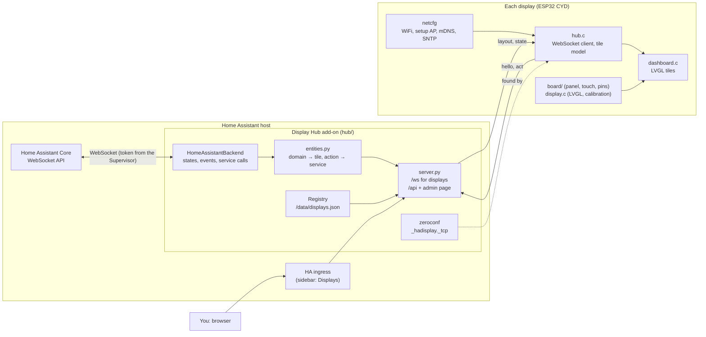
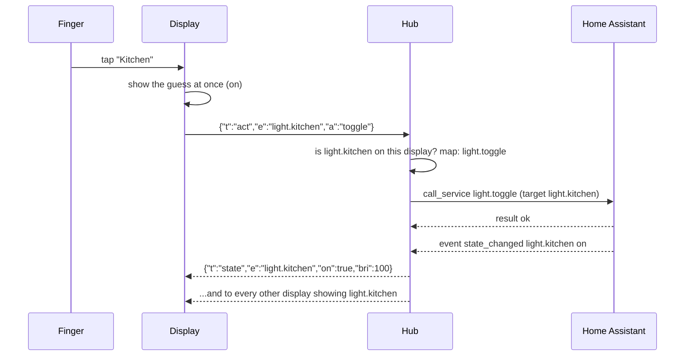
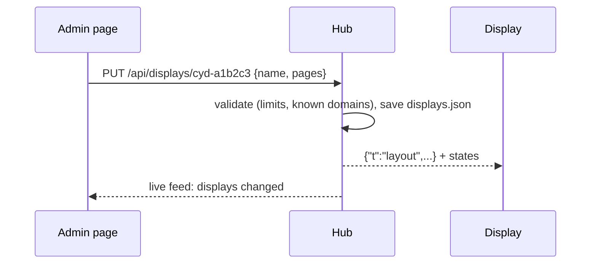
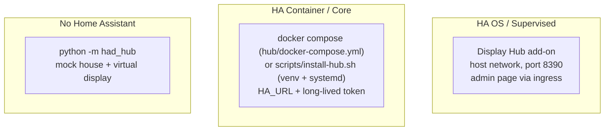
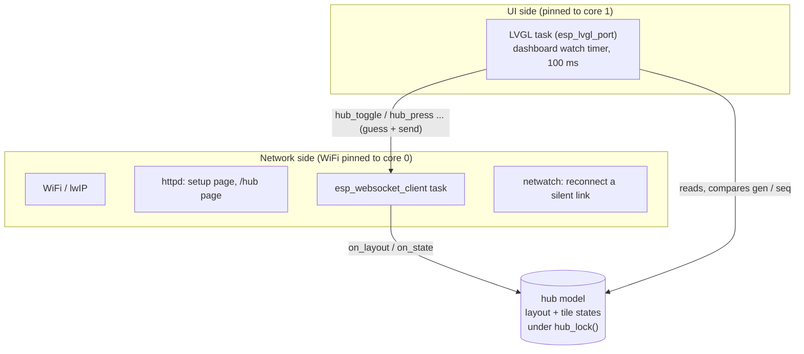

# Architecture

Three parts: **displays** (ESP32 touchscreens running the firmware in this
repo), the **hub** (a small Python server, normally a Home Assistant
add-on), and **Home Assistant** itself.

The displays know nothing about Home Assistant. They draw tiles and report
taps. The hub knows which tiles belong on which display, keeps one
connection to Home Assistant, cuts its states down to the few fields a tile
needs, and turns taps into service calls.

## Why a hub, and not displays talking to Home Assistant directly

- **Memory.** A display has about 50 KB of RAM free once WiFi and the
  screen are running. Home Assistant's own messages are large: `get_states`
  alone is hundreds of KB in a typical house. The hub sends a display only
  its own tiles, in messages of a few hundred bytes.
- **No secrets on the displays.** Only the hub holds a Home Assistant
  token (as an add-on, the Supervisor provides it). A display holds nothing
  worth stealing.
- **One place to set up.** Displays introduce themselves to the hub. You
  pick their tiles in one admin page, and a change appears on the display
  at once, with no reflashing.
- **Cheap to extend.** New Home Assistant domains are mapped in the hub
  onto tile kinds the firmware already draws, so most additions never touch
  the firmware.

## The pieces



## What happens when

### A display starts

```mermaid
sequenceDiagram
    participant D as Display
    participant M as mDNS
    participant H as Hub
    participant A as Home Assistant
    D->>D: join WiFi (saved networks; else the setup AP)
    D->>M: who is _hadisplay._tcp?
    M-->>D: hub at 192.168.1.20:8390, path /ws
    D->>H: WebSocket /ws
    D->>H: {"t":"hello","id":"cyd-a1b2c3",...}
    H->>H: registry.seen(): new displays are added with no pages
    H-->>D: {"t":"layout",...} (or "Not set up yet")
    loop every tile
        H-->>D: {"t":"state","e":...}
    end
    Note over H,A: The hub already follows HA's state_changed events.<br/>It does not ask HA anything per display.
```

A display checks for a hub address in this order: one saved from its own
web page (`http://<name>.local/hub`), then `CONFIG_HAD_HUB_URL` from
menuconfig, then mDNS. While it is offline it reconnects, and after 30 s it
asks mDNS again in case the hub has moved.

### Someone taps a tile



If Home Assistant refuses (say, an unsupported mode), the hub sends the
display an `error`, which appears as a toast, and then the real state,
which undoes the guess.

### You change a layout



**Identify** (`POST /api/displays/<id>/identify`) makes the display show its
id full-screen for 10 s, so you can tell which physical panel is which.

### Home Assistant restarts

The backend reconnects with a back-off (1 s, doubling up to 30 s), then
reloads every state. Displays keep showing the last known state meanwhile,
taps get an error toast, and the admin page shows a banner. Entities that
have disappeared from HA become `unavailable` on the displays.

## Ways to run the hub



| | Add-on | Docker / venv | Mock |
|---|---|---|---|
| Talks to | HA through the Supervisor (`ws://supervisor/core/websocket`) | HA at `HA_URL` with `HA_TOKEN` | A pretend house |
| Token | provided by the Supervisor | a long-lived access token | none |
| Layouts kept in | `/data/displays.json` (in HA backups) | `hub-data/displays.json` | `hub-data/displays.json` |
| Admin page | HA sidebar (ingress, HA's login); LAN only if `lan_admin` | `http://host:8390/`, optionally limited with `HUB_ADMIN_FROM` | `http://localhost:8390/` |
| Displays connect to | `ws://<HA host>:8390/ws` | `ws://<host>:8390/ws` | `ws://<host>:8390/ws` |

## Inside the firmware



- `components/netcfg`: WiFi (up to 5 networks, tried in turn), the open
  setup access point when nothing can be joined, the setup web page, mDNS
  name, SNTP, and a watchdog that reconnects when traffic stops.
- `components/hub`: finds the hub, holds the WebSocket, parses `layout` and
  `state` into a fixed-size model (no allocation per tile), sends actions.
  `hub_web.c` serves `http://<name>.local/hub`.
- `components/display`: the LCD and LVGL, touch calibration, the dashboard
  (tiles, paging, identify overlay, error toasts), the Setup screen and the
  on-screen WiFi setup.
- The model is the only thing the two sides share. The WebSocket task never
  calls LVGL, and the UI never blocks on the network. The UI notices change
  by comparing `gen` (new layout) and each tile's `seq` (new state).

Memory is the constraint that shapes everything: no PSRAM, about 50 KB free
after WiFi and LVGL. Only the current page's tiles exist as LVGL objects,
fonts are limited to four sizes, Bluetooth is off, and the hub enforces the
tile limits so a display is never sent more than it can hold.

## Data the hub keeps

`displays.json`, rewritten whole (atomically) on every change:

```json
{
  "displays": {
    "cyd-a1b2c3": {
      "name": "Kitchen",
      "pages": [
        {"name": "Lights", "tiles": [
          {"entity": "light.kitchen"},
          {"entity": "sensor.kitchen_co2", "name": "CO2", "warn": 900}
        ]}
      ],
      "last_seen": 1762761600.0,
      "info": {"name": "home-display-a1b2c3", "fw": "0.3.0", "ip": "192.168.1.57"}
    }
  }
}
```

A display's id comes from its MAC, so it survives reflashing. Its layout
stays with the hub, so a replacement display only needs to be given the old
one's layout (the admin page's "Copy layout from").

## Security

- The display WebSocket is unauthenticated, as on any trusted LAN device. A
  display, or anything pretending to be one, can only act on entities
  assigned to its id, and only with the actions those tiles have.
- As an add-on, the admin page and its API are reachable only through HA's
  ingress, behind HA's login. With the `lan_admin` option they are open to
  the LAN without a login, so leave it off unless you need it.
- Standalone, the admin page is open to anyone who can reach port 8390
  unless you set `HUB_ADMIN_FROM` / `--admin-from`.
- Think before putting a lock or garage door on a display in a place
  visitors can reach.
