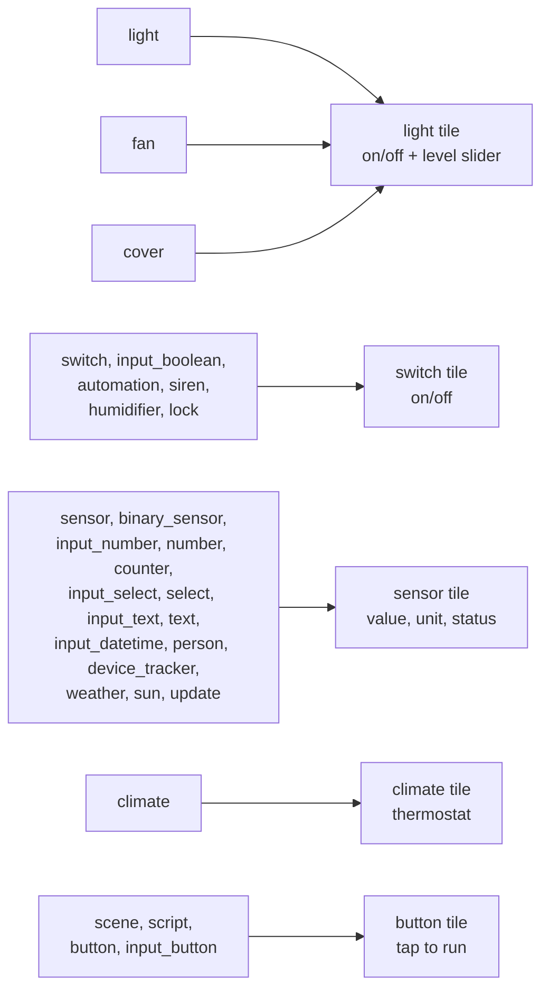

# Entity types

Which Home Assistant entities can go on a display, how each one looks, and
what tapping it does.

The display draws five **tile kinds**. The hub maps each Home Assistant
**domain** onto one of them, and decides what the on/off, the level and the
words mean for that domain. Adding a domain to an existing kind is a
hub-only change; see [extending.md](extending.md). The mapping lives in
[`hub/had_hub/entities.py`](../hub/had_hub/entities.py).

## The tile kinds

| Kind | On screen | Taps |
|---|---|---|
| **light** | Name, a corner symbol, on/off or the hub's words, and a 0-100 slider when the entity has a level | Tap the card: toggle. Drag the slider: set the level |
| **switch** | Name, a corner symbol, on/off or the hub's words, and a switch | Tap the card: toggle |
| **sensor** | Name, a big value and unit, and a status line (Good / Fair / Poor, or the hub's words), coloured green / amber / red by level | None |
| **climate** | Full width: current temperature, heating / cooling / idle, target with − and +, and a mode button | − / + change the target (sent when the taps stop); the mode button cycles through the modes |
| **button** | Name, a ▶ symbol, and "Activate" / "Run" / "Running" / "Press" | Tap: run it. The card flashes; a script stays lit while it runs |

Every tile shows "unavailable" and dims when Home Assistant reports the
entity as `unavailable` or `unknown`. The display shows the result of a tap
immediately, and the hub's next update confirms or corrects it.

## Every supported domain

### Light tiles

| Domain | On means | Level (slider) | Status words | Tap | Slider | Notes |
|---|---|---|---|---|---|---|
| `light` | `on` | brightness, when the light has a colour mode other than `onoff` | "On 70%", "Off" | `light.toggle` | `light.turn_on` `brightness_pct`; 0 = `light.turn_off` | |
| `fan` | `on` | `percentage`, when the fan supports set-speed | "On 40%", "Off" | `fan.toggle` | `fan.set_percentage`; 0 = `fan.turn_off` | Corner: fan symbol |
| `cover` | `open` or `opening` | `current_position`, when the cover supports set-position | "Open 40%", "Open", "Closed", "Opening", "Closing" | `cover.toggle` | `cover.set_cover_position` | Blinds, shades, garage doors, gates. Corner: up/down arrows |

### Switch tiles

| Domain | On means | Status words | Tap | Notes |
|---|---|---|---|---|
| `switch` | `on` | On / Off | `switch.toggle` | |
| `input_boolean` | `on` | On / Off | `input_boolean.toggle` | Helpers ("Guest mode") |
| `automation` | `on` (enabled) | Enabled / Disabled | `automation.toggle` | Turns the automation on or off; it does not run it |
| `siren` | `on` | On / Off | `siren.toggle` | Corner: bell |
| `humidifier` | `on` | On / Off | `humidifier.toggle` | On/off only; the target humidity is not shown |
| `lock` | `locked` | Locked / Unlocked / Locking / Unlocking / Jammed! / Open | `lock.lock` or `lock.unlock` | Put a lock only on a display you are happy to unlock a door from. Locks needing a code are not supported |

### Sensor tiles

| Domain | Value | Unit | Status line | Notes |
|---|---|---|---|---|
| `sensor` (numeric) | the state, rounded | `unit_of_measurement` | Good / Fair / Poor when the device class has thresholds (below) or the tile has its own; blank otherwise | Rounding follows the display precision set in HA, then the device class, then whole numbers if the value is whole |
| `sensor` (text, enum) | the state, cut to 11 characters | | | |
| `sensor` (timestamp) | the time if today, else the date ("14:05", "03 Nov") | | | In the hub's time zone |
| `binary_sensor` | words by device class (table below) | | Good / Poor for alarms ("OK" / "Alert"), blank otherwise | |
| `input_number`, `number` | the value | `unit_of_measurement` | thresholds, if set on the tile | Display only: the display cannot set numbers |
| `counter` | the count | | thresholds, if set on the tile | |
| `input_select`, `select` | the selected option | | | Display only |
| `input_text`, `text` | the text | | | Display only |
| `input_datetime` | the state | | | |
| `person`, `device_tracker` | Home / Away / the zone name | | | |
| `weather` | the temperature | `temperature_unit` | the condition: Sunny, Partly cloudy, Rain, Snow, Storms... | |
| `sun` | Up / Down | | | |
| `update` | Update / Current | | amber when an update is available | |

**Sensor thresholds** (Good below warn, Fair from warn, Poor from bad). A
tile can override them in the admin page ("Warn ≥", "Bad ≥"); if warn is
above bad, lower is worse.

| Device class | Warn | Bad | Unit |
|---|---|---|---|
| `carbon_dioxide` | 1000 | 1500 | ppm |
| `carbon_monoxide` | 9 | 35 | ppm |
| `volatile_organic_compounds_parts` | 220 | 660 | ppb |
| `volatile_organic_compounds` | 300 | 1000 | µg/m³ |
| `pm25` | 12 | 35 | µg/m³ |
| `pm10` | 54 | 154 | µg/m³ |
| `aqi` | 51 | 151 | |
| `battery` | ≤ 20 | ≤ 10 | % (lower is worse) |

**Binary sensor words** by device class (on / off). Classes marked ⚠ are
alarms: red with "Alert" when on, green with "OK" when off.

| Class | On | Off | | Class | On | Off |
|---|---|---|---|---|---|---|
| door, window, opening, garage_door | Open | Closed | | battery | Low (amber) | Normal |
| motion | Motion | Clear | | battery_charging | Charging | Not charging |
| occupancy | Occupied | Clear | | connectivity | Connected | Offline |
| presence | Home | Away | | plug | Plugged in | Unplugged |
| lock | Unlocked | Locked | | power | Power | No power |
| light | Light | Dark | | running | Running | Stopped |
| sound | Sound | Quiet | | vibration | Vibration | Still |
| update | Update | Up to date | | *(none)* | On | Off |
| ⚠ smoke | Smoke! | Clear | | ⚠ gas | Gas! | Clear |
| ⚠ carbon_monoxide | CO! | Clear | | ⚠ moisture | Wet | Dry |
| ⚠ problem | Problem | OK | | ⚠ safety | Unsafe | Safe |
| ⚠ tamper | Tampered | OK | | ⚠ heat / ⚠ cold | Hot / Cold | Normal |

### Climate tiles

| Domain | Shows | − / + | Mode button | Notes |
|---|---|---|---|---|
| `climate` | `current_temperature`, `hvac_action` (Heating / Cooling / Idle / Off), the target `temperature` | `climate.set_temperature`, in `target_temp_step` steps, kept within `min_temp`–`max_temp` | `climate.set_hvac_mode`, cycling through up to four of off, heat, cool, auto, heat_cool, dry, fan_only | Single-target thermostats. In a two-target mode (heat_cool with a low and a high), the target shows "--" and − / + do nothing |

### Button tiles

| Domain | Status words | Tap | Notes |
|---|---|---|---|
| `scene` | Activate | `scene.turn_on` | |
| `script` | Run, or Running (lit) while it runs | `script.turn_on` | Scripts that need fields are not supported |
| `button` | Press | `button.press` | Device buttons (restart, identify...) |
| `input_button` | Press | `input_button.press` | Helpers, for automations to listen to |

## What is not supported (yet)

`media_player`, `camera`, `alarm_control_panel`, `vacuum`, `lawn_mower`,
`valve`, `water_heater`, `remote`, `calendar`, `todo`, colour and colour
temperature of lights, fan presets and oscillation, cover tilt, and
two-target thermostats. The admin page only offers entities whose domain is
supported. Several of these fit an existing kind, and are hub-only changes;
[extending.md](extending.md) shows how.

## Limits

Set by what the firmware holds in its ~50 KB of free RAM, and enforced by
the hub when you save a layout:

| | Limit |
|---|---|
| Pages per display | 6 |
| Tiles per page | 8 (two across; a thermostat is full width; the page scrolls) |
| Tiles per display | 24 |
| Tile label | 23 bytes |
| Page name | 15 bytes |
| Entity id | 63 bytes |
| Sensor value / unit / status | 11 / 7 / 15 bytes (the hub shortens them) |
