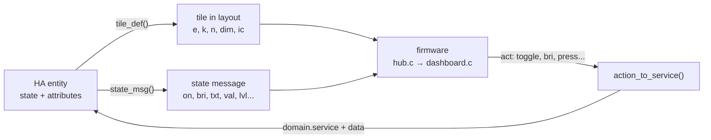

# Extending

Most changes touch only one of the three layers. Start from the smallest
one that does the job:

| You want to... | Change | Firmware rebuild? |
|---|---|---|
| Show a new Home Assistant domain with an existing tile kind | `hub/had_hub/entities.py` | No |
| Change words, thresholds, rounding or icons | `hub/had_hub/entities.py` | No (new icons: yes) |
| A new kind of tile (a new look or new controls) | hub + firmware + virtual display | Yes |
| Another source of states than Home Assistant | a new backend in `hub/had_hub/backends/` | No |
| Something on the display that is not a tile (a screen, a sensor on the board) | `components/` | Yes |

Run the checks before and after: `make test` runs the hub's tests and
builds the firmware.



Everything domain-specific is in those three functions in `entities.py`.

## Add a domain to an existing tile kind

Example: show `valve` entities (water valves) as switch tiles: open is on,
and a tap opens or closes them.

1. **Map the domain to a kind** in `KIND_BY_DOMAIN`:

   ```python
   "valve": "switch",
   ```

   Optionally give it a corner symbol in `ICON_BY_DOMAIN`. The firmware
   knows `fan`, `cover`, `bell`, `lock` and `play`.

2. **Say what its state means** in `state_msg()`, in the `switch` branch:

   ```python
   elif kind == "switch":
       if d == "valve":
           m["on"] = e.state in ("open", "opening")
           m["txt"] = e.state.capitalize()      # "Open", "Closed", "Opening"...
       elif d == "lock":
   ```

   `txt` (up to 15 bytes) replaces the display's own "On"/"Off".

3. **Say what a tap does** in `action_to_service()`:

   ```python
   if domain == "valve":
       opening = (e.state not in ("open", "opening")) if action == "toggle" else action == "on"
       return domain, "open_valve" if opening else "close_valve", data
   ```

4. **Keep the attributes you read.** If the new code reads an attribute
   that is not in `USED_ATTRIBUTES`, add it there. The Home Assistant
   backend drops everything else.

5. **Test it** in `hub/tests/test_kinds.py`, and add one to the mock house
   (`backends/mock.py`, plus its services in `call_service`) so it shows up
   in the virtual display:

   ```python
   def test_valve(self):
       self.assertEqual(msg("valve.v", "open")["on"], True)
       self.assertEqual(call("valve.v", "open", "toggle")[1], "close_valve")
   ```

6. Add a row to [entities.md](entities.md).

The admin page and the firmware need no changes. The admin page offers any
domain in `KIND_BY_DOMAIN`, and the display draws the tile kind it already
knows.

### Sensor tweaks

- Thresholds by device class: `DEFAULT_LEVELS` (warn, bad). Use warn > bad
  when lower is worse.
- Rounding by device class: `DEFAULT_PRECISION`. HA's own display precision
  wins when it is set.
- Binary sensor words: `BINARY_WORDS`. Alarm classes: `BINARY_ALARMS`.
- Weather words: `WEATHER_WORDS`.

## Add a new tile kind

Example: a `media` tile with play/pause and volume. All four places speak
the protocol, so all four change:

1. **Protocol** ([protocol.md](protocol.md)): name the kind (`"k":"media"`),
   its state fields (`title`, `playing`, `vol`), and its actions (`play`,
   `pause`, `vol`). Keep keys short. Old firmware skips kinds and fields it
   does not know, so existing displays keep working.
2. **Hub** (`entities.py`): map the domain (`"media_player": "media"`), and
   extend `tile_def()`, `state_msg()`, `action_to_service()` and
   `USED_ATTRIBUTES` (`media_title`, `volume_level`). Add tests.
3. **Firmware**:
   - `components/hub/include/hub.h`: add `HUB_MEDIA` to `hub_kind_t`, and
     any new state to `hub_tile_t`. Every display holds 24 of these, so
     keep new fields small.
   - `components/hub/hub.c`: recognise `"media"` in `on_layout()`, read the
     new fields in `on_state()`, and add a sender such as
     `hub_media(entity, action)`, built on `send_act()` (with a `guess()`
     if the screen should answer before the hub does).
   - `components/display/dashboard.c`: build the tile's widgets in
     `build_tile()`, draw its state in `update()`, and add tap handlers that
     call the new sender. Only the current page's tiles exist, so widgets
     are created and destroyed as pages turn: anything with a timer must be
     deleted in `clear_page()`.
4. **Virtual display** (`hub/had_hub/static/virtual.html`): draw it in
   `tile()`, so it can be tried without hardware.
5. **Admin page** (`index.html`): optional, an icon in `KIND_ICON` and a
   control in `renderEntity()`.

Watch the RAM. `Setup` on the display shows free memory. Keep about 20 KB
free after the busiest page.

## Add a backend

A backend is where states come from and where service calls go. Subclass
`Backend` (`hub/had_hub/backends/base.py`):

```python
class MyBackend(Backend):
    name = "mine"

    async def start(self):            # connect; call self._set(entity_id, state, attrs) for each entity
        ...

    async def stop(self):
        ...

    async def call_service(self, domain, service, data):
        ...                            # do it; then _set() the new state (or wait for the event)

    def status(self):
        return {"connected": True, "detail": ""}
```

Use Home Assistant's shapes (entity ids, states, attributes, services), and
everything above the backend works unchanged. Register it in
`backends/__init__.py`, and add a choice in `__main__.py`.
`backends/homeassistant.py` is the full example, with reconnection and
trimming; `backends/mock.py` is the small one.

## Change the firmware for a different board

Boards live in `components/board`. Each is an entry in `boards.c`: screen
size, panel controller and pins, colour order and orientation, backlight,
and touch controller (XPT2046 on its own pins or on the LCD's bus, GT911
or FT6336 on I2C). To add one:

1. Add a choice under **Board** in `main/Kconfig.projbuild`, and its entry
   in `boards.c`.
2. Add `boards/<id>/sdkconfig.defaults` selecting it, and an environment in
   `platformio.ini` that uses it (copy `[env:st7796r]`).
3. Another panel controller needs its `esp_lcd` driver in
   `components/board/idf_component.yml` and a case in `board_spi.c`.

The UI scales itself from the screen size (`components/display/ui.c`):
everything drawn for 320×240 grows by one factor, fonts step up, and
screens 800 px wide or more put four tiles across. `hello` tells the hub
the screen size and board.

## Protocol changes

The protocol is versioned (`"proto":1` in `hello`). Adding kinds, fields or
actions is backwards compatible, because both sides ignore what they do not
know. Changing what an existing field means is not: bump `PROTO` in both
`components/hub/hub.c` and `hub/had_hub/server.py`, and have the hub check
the display's version.

## Releasing

1. Bump the version: `CMakeLists.txt` (`PROJECT_VER`, the firmware),
   `hub/had_hub/__init__.py` and `hub/config.yaml` (the add-on: Home
   Assistant offers an update when this changes), and
   `hub/CHANGELOG.md`.
2. `make test`.
3. Commit, then tag and push: `git tag v0.4.0 && git push --tags`. The
   release workflow builds the firmware image and attaches it to a GitHub
   release.
