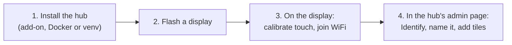

# Installing

Two things to install: the **hub**, once, next to Home Assistant, and the
**firmware**, on each display. Then you join each display to WiFi and pick
its tiles.



## 1. The hub

### As a Home Assistant add-on (HA OS or Supervised)

This is the simplest option. The add-on gets its access to Home Assistant from the Supervisor, so
there is no token to make, and its admin page appears in HA's sidebar.

[](https://my.home-assistant.io/redirect/supervisor_add_addon_repository/?repository_url=https%3A%2F%2Fgithub.com%2Fgeekychris%2FHomeAutomationDisplay)

Or by hand:

1. In Home Assistant, go to **Settings → Add-ons → Add-on store**, open the
   ⋮ menu, choose **Repositories**, and add
   `https://github.com/geekychris/HomeAutomationDisplay`.
2. Find **Display Hub** in the store (reload the page if it does not show)
   and press **Install**. Home Assistant builds it on your machine; it
   takes a minute or two.
3. Press **Start**. Turn on **Show in sidebar**.
4. Open **Displays** in the sidebar. The banner should be gone, and **House**
   should list your entities.

Options (the add-on's **Configuration** tab):

| Option | Default | |
|---|---|---|
| `lan_admin` | off | Also serve the admin page at `http://<HA>:8390/` to the whole LAN, without a login |
| `mdns` | on | Advertise the hub so displays find it by themselves |
| `advertise_ip` | blank | The address displays should use, if the host has several |
| `log_level` | info | |

The add-on uses the host's network, because displays connect to port 8390
directly and find the hub with mDNS. Port 8390 must be free on the host.
Supported on 64-bit hosts: aarch64 (Raspberry Pi 4/5 with a 64-bit OS) and
amd64.

### With Docker (HA Container or Core, or another machine)

You need a long-lived access token. In Home Assistant, click your name
(bottom left), open **Security**, and under **Long-lived access tokens**
choose **Create token**.

```sh
git clone https://github.com/geekychris/HomeAutomationDisplay
cd HomeAutomationDisplay/hub
cp .env.example .env        # set HA_URL and HA_TOKEN
docker compose up -d
```

The admin page is at `http://<this machine>:8390/`. To keep it for your
own machines, set `HUB_ADMIN_FROM=192.168.1.0/24` (or single addresses) in
`.env`.

### In a Python virtualenv (Linux or macOS)

```sh
echo 'paste-the-token' > ~/ha-token && chmod 600 ~/ha-token
scripts/install-hub.sh --ha-url http://homeassistant.local:8123 --token-file ~/ha-token
```

This installs into `~/.local/share/had-hub`. On Linux with systemd it adds
the user service `had-hub`, which starts at boot; follow it with
`journalctl --user -u had-hub -f`. On a Mac it prints the command to start
it.

### Just trying it (no Home Assistant)

```sh
make hub            # or: cd hub && python3 -m venv .venv && .venv/bin/pip install -r requirements.txt && .venv/bin/python -m had_hub
```

This gives you a mock house at `http://localhost:8390/`, and a virtual display at
`http://localhost:8390/virtual`.

## 2. The firmware

You need an ESP32 "Cheap Yellow Display": the ESP32-2432S028R, or a clone
such as the ELEGOO 2.8" E32R28T. Connect it by USB. It has a CH340 serial
chip; macOS and Linux have drivers built in, and Windows may need the
CH340 driver.

**From a release** (no tools to install beyond esptool):

```sh
pip install esptool
esptool.py --chip esp32 --port /dev/cu.usbserial-110 --baud 460800 \
    write_flash 0x0 home-automation-display-0.3.0.bin
```

Download `home-automation-display-<version>.bin` from the
[releases](https://github.com/geekychris/HomeAutomationDisplay/releases)
page. On Windows the port is `COM3` or similar; on Linux it is
`/dev/ttyUSB0`.

**From source** (needs [PlatformIO](https://platformio.org/install/cli)):

```sh
scripts/flash.sh                          # build and flash; PlatformIO finds the port
scripts/flash.sh /dev/cu.usbserial-110    # or name it
scripts/flash.sh --monitor                # then watch the log
```

`scripts/build-firmware.sh` builds without flashing, and also writes
`dist/home-automation-display-<version>.bin` for flashing at 0x0.

If you build with `pio run` directly, run `scripts/prepare-idf.sh` once
first. PlatformIO's ESP-IDF 5.4 comes with a component manager too old to
read LVGL's manifest; the build then stops with a `pyparsing` traceback.
The scripts and `make` do this for you.

Settings that are compiled in (`pio run -e cyd -t menuconfig`, under **Home
Automation Display**): the network name, a fixed hub address, the setup
network's name, the time zone, and the display and touch pins. If your
panel's colours come out inverted, or the picture is mirrored, turn on
`HAD_LCD_INVERT` or `HAD_LCD_MIRROR_X`.

## 3. On the display

1. **Touch calibration** runs on first boot. Tap and hold each cross until
   it turns green. You can repeat it later from Setup, or by holding the
   BOOT button.
2. **WiFi.** Tap the gear in the top bar, then **WiFi**. Pick your network
   and type its password. The display tries up to five saved networks in
   turn.

   If you prefer a phone, join the open network `home-display-setup` and
   open `http://192.168.4.1/`. It appears whenever no saved network can be
   joined.
3. The display then finds the hub by itself. The dot in the top bar turns
   green, and the screen says *Not set up yet* with the display's id.

If the hub is not found (mDNS can be blocked between WiFi and wired
networks, or across VLANs), open `http://home-display-xxxxxx.local/hub` from
a computer and enter the hub's address, for example
`ws://192.168.1.20:8390/ws`. Use your display's own name, which is shown
under Setup.

## 4. In the hub's admin page

1. The display appears on the left as soon as it connects. Press
   **Identify**, and that display shows its id for 10 seconds, so you know
   which panel you are editing.
2. Give it a name ("Kitchen").
3. Add pages, and tiles from **+ Add a tile…** (grouped by area when Home
   Assistant has areas). Give tiles shorter labels if you like, and set
   your own warn/bad levels on sensors.
4. Press **Save to display**. The display changes straight away.

**Copy layout from…** starts a display from another one's layout.
**Forget** removes a display and its layout.

## Troubleshooting

| Symptom | Look at |
|---|---|
| Red banner "Not connected to Home Assistant" | The add-on's **Log** tab. Standalone: check `HA_URL` and the token. "token refused" means a wrong or deleted token |
| Display says "looking for the hub" | Is the hub running? Is mDNS reaching the display's network? If not, set the address at `http://<display>.local/hub` |
| Display shows tiles as "unavailable" | The entity is unavailable in HA, or was renamed. Re-add it in the admin page |
| A tap shows a red toast | HA refused the service call. The toast gives HA's reason |
| Touch is off or upside down | Recalibrate: gear → Calibrate touch, or hold BOOT |
| Colours inverted or mirrored | `HAD_LCD_INVERT` / `HAD_LCD_MIRROR_X` in menuconfig |
| Display log | `make monitor` (USB, 115200 baud) |
